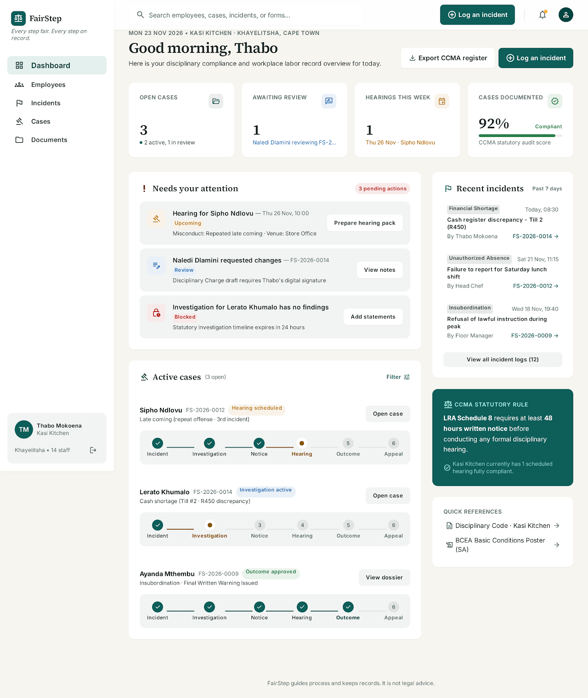
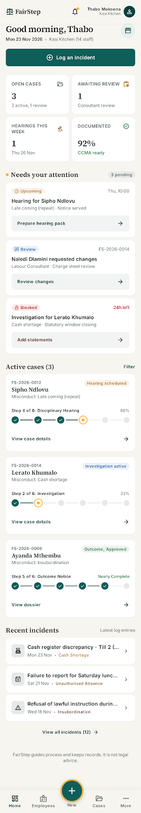
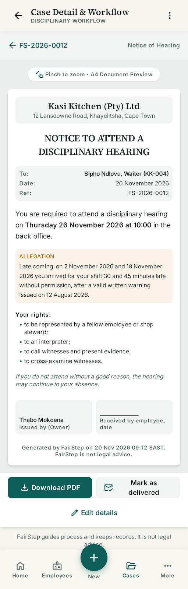

# FairStep

**Every step fair. Every step on record.**

FairStep helps small business owners run fair, fully documented disciplinary processes, so they stop losing CCMA cases on procedure.

> **Status:** Capstone in progress. Final submission due Wed 25 Nov 2026, 15:30 SAST.

|                         |                                                                                               |
| ----------------------- | --------------------------------------------------------------------------------------------- |
| Live app                | _coming in Phase 4 (Vercel)_                                                                  |
| Designs (Google Stitch) | [Stitch project](https://stitch.google.com/projects/4898099028546742169) · exports in [`docs/designs/`](docs/designs/) |
| Business case           | [BUSINESS.md](BUSINESS.md)                                                                    |
| Product requirements    | [docs/PRD.md](docs/PRD.md)                                                                    |
| Stitch prompts          | [docs/stitch-prompts.md](docs/stitch-prompts.md)                                              |
| Implementation plan     | [IMPLEMENTATION_PLAN.md](IMPLEMENTATION_PLAN.md) |

## The problem

- The CCMA registered **193,069 referrals in 2024/25**, and **51% were unfair dismissal** disputes ([Business Day, Sept 2026](https://www.businessday.co.za/news/2026-09-23-unfair-dismissals-make-up-more-than-half-of-ccma-cases/)).
- About **60% of the CCMA caseload** has historically come from small, medium and micro enterprises ([Engineering News, CCMA 2018/19](https://www.engineeringnews.co.za/article/large-scale-dismissals-continue-to-rise-in-labour-market-on-back-of-legislative-reform-4ir-2019-10-14)).
- Employers with legitimate cases often lose because the procedure was unfair, or the paperwork was wrong, lost or never recorded ([SME South Africa](https://smesouthafrica.co.za/why-employers-lose-ccma-cases/)).

A business with 8 employees has no HR department and can't pay a lawyer for every warning.

## The solution

FairStep is a mobile-first case manager. It guides an owner from **incident → investigation → notice of hearing → hearing → outcome → appeal**, in line with the 2025 _Code of Good Practice: Dismissal_. It **blocks unfair steps** and explains why in plain language. It generates the letters, lets the owner's labour consultant review and sign off the case, and exports the whole case as a timestamped, **CCMA-ready bundle**.

## Designs

Designed in Google Stitch (link above) from the prompts in [docs/stitch-prompts.md](docs/stitch-prompts.md). All exports are in [`docs/designs/`](docs/designs/).

The design system (colours, type, spacing) is in [docs/designs/design-system.md](docs/designs/design-system.md). File numbers match the screen numbers in the prompts.

| Screen                                   | Mobile                                               | Desktop                                                   |
| ---------------------------------------- | ---------------------------------------------------- | --------------------------------------------------------- |
| 01 Landing page                          | [mobile](docs/designs/01-landing-mobile.png)         | [desktop](docs/designs/01-landing-desktop.png)            |
| 02 Log in                                | [mobile](docs/designs/02-login-mobile.png)           | [desktop](docs/designs/02-login-desktop.png)              |
| 03 Owner dashboard                       | [mobile](docs/designs/03-owner-dashboard-mobile.png) | [desktop](docs/designs/03-owner-dashboard-desktop.png)    |
| 04 Add employee                          | [mobile](docs/designs/04-add-employee-mobile.png)    | [desktop](docs/designs/04-add-employee-desktop.png)       |
| 06 Log an incident                       | [mobile](docs/designs/06-new-incident-mobile.png)    | –                                                         |
| 07 Cases + workflow stepper              | –                                                    | [desktop](docs/designs/07-cases-workflow-desktop.png)     |
| 07 CCMA-ready bundle export              | –                                                    | [desktop](docs/designs/07-case-bundle-export-desktop.png) |
| 08 Hearing notice preview                | [mobile](docs/designs/08-hearing-notice-mobile.png)  | [desktop](docs/designs/08-hearing-notice-desktop.png)     |
| 09 Consultant review queue               | [mobile](docs/designs/09-review-queue-mobile.png)    | [desktop](docs/designs/09-review-queue-desktop.png)       |
| 11 Admin: businesses + assign consultant | –                                                    | [desktop](docs/designs/11-admin-businesses-desktop.png)   |
| 11 Admin: audit log                      | –                                                    | [desktop](docs/designs/11-admin-audit-log-desktop.png)    |

  
  
  

**Building from the designs.** The designs set the layout, components and visual style. Where the generated copy conflicts with the [PRD](docs/PRD.md), the PRD wins. For example, the app refers to the 2025 _Code of Good Practice: Dismissal_ (not "Schedule 8"), uses "2 working days' notice" (not "48 hours"), and makes no cryptographic or "tamper-proof" claims. Screens without a design (employee detail, consultant case review, mobile stepper) reuse the same components.

## Who it's for

| Role                          | What they do                                                               |
| ----------------------------- | -------------------------------------------------------------------------- |
| Business owner / case manager | Keeps the employee register, logs incidents, runs cases, generates letters |
| Labour consultant             | Reviews, comments on and signs off cases for assigned client businesses    |
| Platform admin                | Manages users, businesses and consultant assignments                       |

## Planned stack

Next.js (App Router) · TypeScript (strict) · Tailwind CSS · Supabase (Postgres, Auth, Storage, Row Level Security) · @react-pdf/renderer · Vitest + React Testing Library · Playwright · GitHub Actions · Vercel

## Disclaimer

FairStep provides process guidance and record-keeping. **It is not legal advice.** Rules and notice periods are configurable and should be verified by a qualified labour practitioner. For advice on a specific matter, consult a labour law professional or the [CCMA](https://www.ccma.org.za/).
