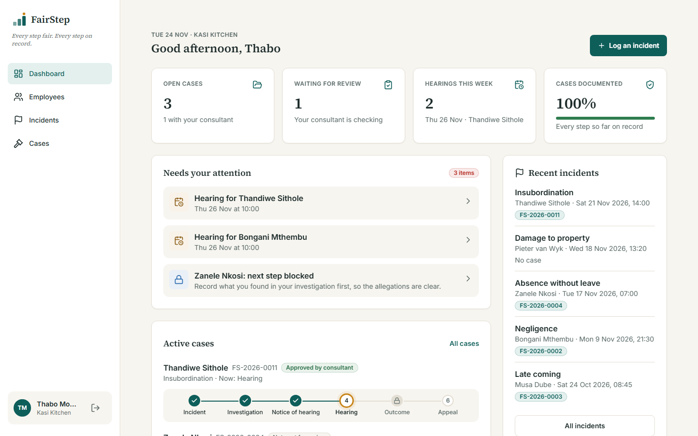
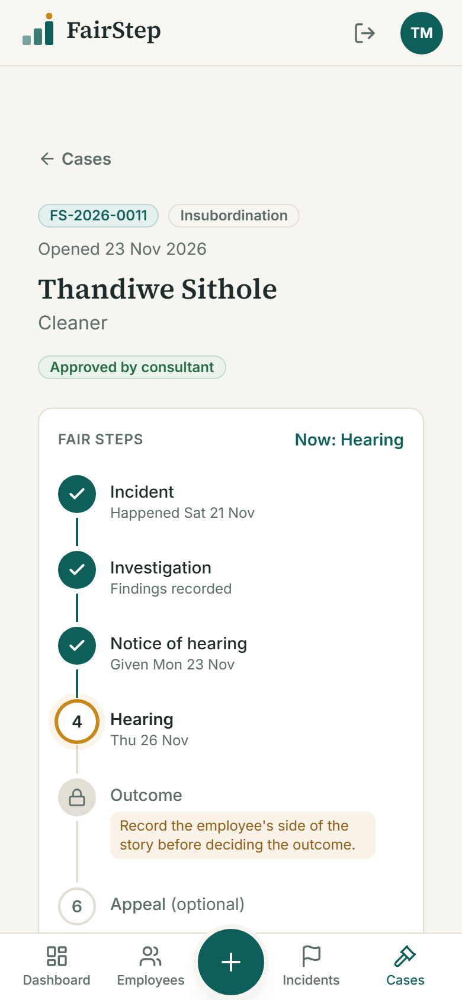
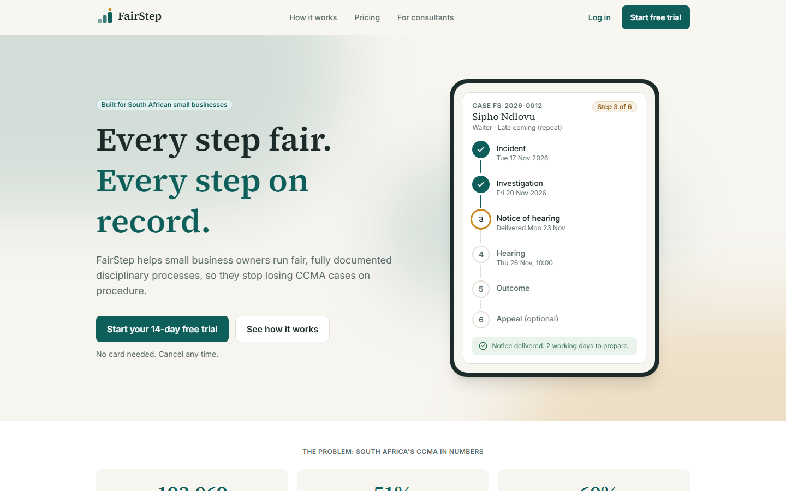
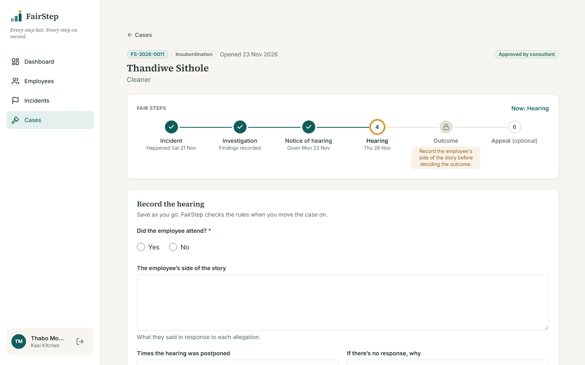
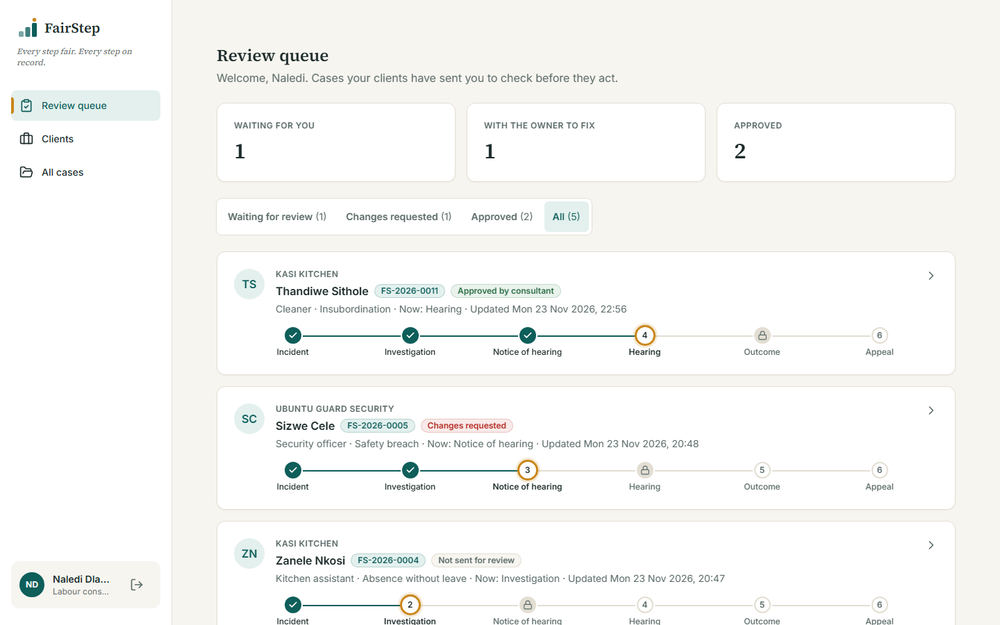
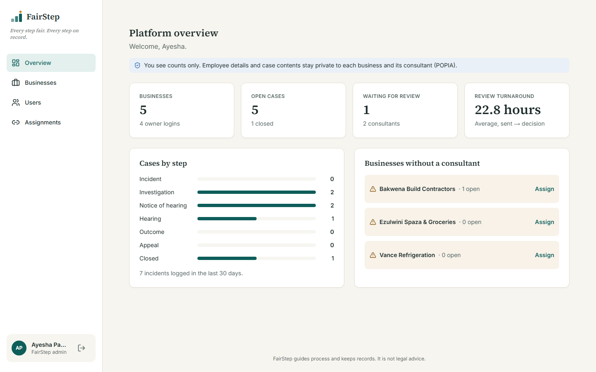
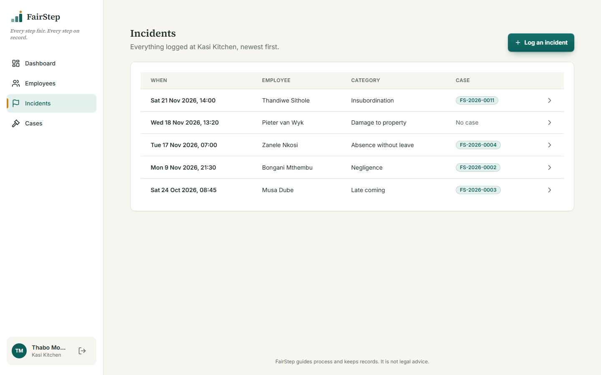
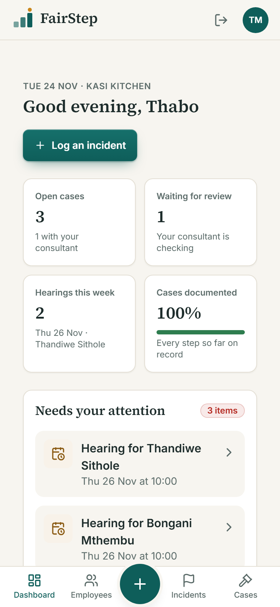
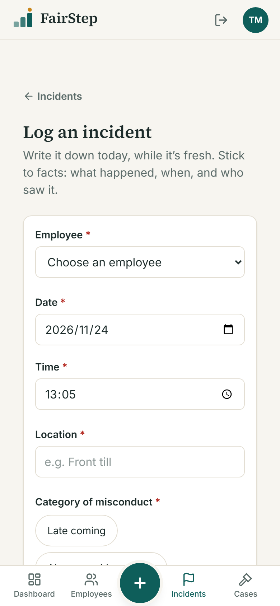
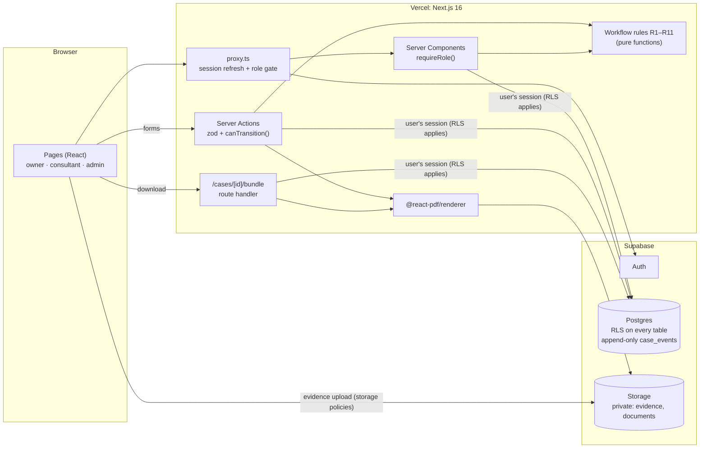

# FairStep

**Every step fair. Every step on record.**

[](https://github.com/mandlenkosii/fairstep/actions/workflows/ci.yml)

FairStep helps small business owners run fair, fully documented disciplinary processes, so they stop losing CCMA cases on procedure.

|                         |                                                                                                                        |
| ----------------------- | ---------------------------------------------------------------------------------------------------------------------- |
| **Live app**            | **[fairstep.vercel.app](https://fairstep.vercel.app)** (test logins [below](#try-it))                                   |
| Designs (Google Stitch) | [Stitch project](https://stitch.google.com/projects/4898099028546742169) · exports in [`docs/designs/`](docs/designs/) |
| Business case           | [BUSINESS.md](BUSINESS.md)                                                                                             |
| Product requirements    | [docs/PRD.md](docs/PRD.md) (roles, rules R1–R11, data model, permission matrix)                                        |
| Implementation plan     | [IMPLEMENTATION_PLAN.md](IMPLEMENTATION_PLAN.md)                                                                       |
| QA checklist            | [docs/QA.md](docs/QA.md)                                                                                               |
| Demo video (Loom)       | Script: [docs/LOOM_SCRIPT.md](docs/LOOM_SCRIPT.md) · video link added on submission                                    |

<p>
  
  
</p>

## The problem

- The CCMA registered **193,069 referrals in 2024/25**, and **51% were unfair dismissal** disputes ([Business Day, Sept 2026](https://www.businessday.co.za/news/2026-09-23-unfair-dismissals-make-up-more-than-half-of-ccma-cases/)).
- About **60% of the CCMA caseload** has historically come from small, medium and micro enterprises ([Engineering News, CCMA 2018/19](https://www.engineeringnews.co.za/article/large-scale-dismissals-continue-to-rise-in-labour-market-on-back-of-legislative-reform-4ir-2019-10-14)).
- Employers with legitimate cases often lose because the procedure was unfair, or the paperwork was wrong, lost or never recorded ([SME South Africa](https://smesouthafrica.co.za/why-employers-lose-ccma-cases/)).

A business with 8 employees has no HR department and can't pay a lawyer for every warning.

## The solution

FairStep guides an owner from **incident → investigation → notice of hearing → hearing → outcome → appeal**, following the 2025 _Code of Good Practice: Dismissal_. It **blocks unfair steps** and explains why in plain language, generates the letters, lets the owner's labour consultant review and sign off the case, and exports the whole case as one timestamped, **CCMA-ready bundle**.

## Try it

Open **https://fairstep.vercel.app** and log in. All three test logins use the password **`FairStep-demo-2026`**.

| Role                                         | Email                       | What they see                                          |
| -------------------------------------------- | --------------------------- | ------------------------------------------------------ |
| Business owner (Thabo Mokoena, Kasi Kitchen) | `thabo@kasikitchen.test`    | Only Kasi Kitchen: employees, incidents, cases         |
| Labour consultant (Naledi Dlamini)           | `naledi@dlaminilabour.test` | Only her two assigned clients; review queue            |
| Platform admin (Ayesha Patel)                | `admin@fairstep.test`       | All businesses as **counts only**, users, assignments  |

**A two-minute tour**

1. **Owner:** open **Cases → Thandiwe Sithole (FS-2026-0011)**. The Outcome step is locked with the reason: _"Record the employee's side of the story before deciding the outcome."_
2. **Owner:** open **Zanele Nkosi**. Notice of hearing is blocked until the investigation findings are recorded. Record them, move to the notice, then try a hearing tomorrow or the complainant as chairperson: FairStep explains why it can't continue.
3. **Owner:** on any case, **Export case bundle (PDF)**, or generate the **notice of hearing**.
4. **Consultant:** the review queue shows only Kasi Kitchen and Ubuntu Guard; approve, or request changes with a comment.
5. **Admin:** platform numbers and consultant assignments, without any employee names.

All people and businesses in the demo data are fictional. Visitors can change the demo data, and case history can't be deleted (by design).

## Features

| | Feature | What it does |
| --- | --- | --- |
| M1 | **Employee register + incident log** | Add, edit, archive and search employees (POPIA-minimal: no ID numbers or addresses). Log incidents with date/time, category, facts, witnesses and photo/PDF evidence in private storage. |
| M2 | **Guided workflow** | Six steps with a progress stepper. Rules R1–R11 (step order, findings first, 2 working days' notice, complete notice, impartial chair, right to respond, postpone once, reasons for dismissal, appeal window, warning expiry, locked when closed) block unfair moves with a plain-language reason. |
| M3 | **PDF letters** | Notice of hearing, written warning, final written warning and outcome letter, generated on the server from the case, saved privately, with reference, SAST timestamp and a "not legal advice" footer. |
| M4 | **Consultant review** | The owner sends a case for review; the assigned consultant comments, requests changes (comment required) or approves. Every change is on the timeline. |
| M5 | **Timeline + CCMA bundle** | An append-only timeline (who, role, what, when) and a one-PDF export with cover, step checklist with dates, the full record, timeline, comments, evidence and letters. |
| S1 | **Owner dashboard** | Open cases, waiting for review, hearings this week, **% of cases documented** (the impact metric), and a "needs your attention" list. |
| + | **Admin** | Platform statistics (counts only), businesses, users and roles, consultant assignments. |

<details>
<summary><strong>More screenshots</strong></summary>

| | |
| --- | --- |
|  |  |
|  |  |
|  |   |

</details>

## How fairness and security are enforced

**The rules are code, not hints.** The workflow rules are pure functions in [`src/lib/workflow/`](src/lib/workflow/) (`canTransition(case, toStep, now)`), configured by constants in [`rules.config.ts`](src/lib/workflow/rules.config.ts), each marked _"Verify with a qualified labour practitioner"_. The server re-runs them before every step change, so a button in the browser can never skip one. Working days skip weekends and SA public holidays, and dates are worked out in SAST.

**Access is checked in three places, so a hidden button is never the only protection:**

1. **Proxy** ([`src/proxy.ts`](src/proxy.ts)): refreshes the session; signed-out users go to log in, the wrong role goes to its own home.
2. **Server:** every page and server action calls `requireRole()` / `requireOwnerBusiness()` and validates input with zod.
3. **Database:** **Row Level Security on every table** ([`supabase/migrations/`](supabase/migrations/)). Owners see only their business, consultants only assigned businesses, and admins get aggregate counts through functions that refuse everyone else. Triggers make `case_events` **append-only even for the service role** and stop consultants from changing case facts. Evidence and letters live in **private** storage buckets, opened through links that expire after 10 minutes.

**POPIA:** only what a case needs (no ID numbers, addresses, banking or medical details); admins see no employee data.

## Tech stack

| Area | Choice |
| --- | --- |
| App | Next.js 16 (App Router, Server Components, Server Actions, `proxy.ts`), React 19, TypeScript (strict) |
| UI | Tailwind CSS 4 with FairStep design tokens, lucide icons, [motion](https://motion.dev) for calm animations (reduced-motion respected) |
| Data | Supabase: Postgres + Row Level Security, Auth (email + password), Storage (private buckets) |
| Validation | zod, shared by forms and server actions |
| PDFs | @react-pdf/renderer, server-side |
| Tests | Vitest + React Testing Library (unit), Vitest against Supabase (RLS), Playwright (end to end) |
| Quality | ESLint, Prettier, GitHub Actions CI on every PR |
| Hosting | Vercel (production + preview per PR) |

## Architecture



```text
src/
  app/            routes: (auth), app/ (owner), consultant/, admin/, cases/[id]/bundle
  components/     ui/, stepper/, shell/, cases/, incidents/, motion/, states/
  lib/
    workflow/     rules R1–R11, dates (SAST, working days), view model
    documents/    letter and bundle builders (pure) + PDF templates
    auth/ cases/ supabase/ validation/
  proxy.ts
supabase/
  migrations/     schema, RLS, storage, admin stats
  tests/          RLS tests
e2e/              Playwright main flow
scripts/          seed.mjs, run.mjs
```

## Run it locally

You need **Node 22+** and a Supabase project (free tier is fine).

```bash
git clone https://github.com/mandlenkosii/fairstep.git
cd fairstep
npm install
cp .env.example .env.local   # then fill it in (see below)
```

Fill in `.env.local` (every variable is explained in [`.env.example`](.env.example)):

| Variable | Where to find it |
| --- | --- |
| `NEXT_PUBLIC_SUPABASE_URL` | Supabase → Connect → App Frameworks |
| `NEXT_PUBLIC_SUPABASE_ANON_KEY` | Same place: the publishable key (`sb_publishable_…`) |
| `SUPABASE_SERVICE_ROLE_KEY` | Project Settings → API Keys → secret key (`sb_secret_…`). Server-only. |
| `SUPABASE_DB_URL` | Connect → Connection String → URI → Session pooler (only for migrations) |
| `NEXT_PUBLIC_SITE_URL` | `http://localhost:3000` |

Then create the tables, add the demo data and start the app:

```bash
set -a && . ./.env.local && set +a                   # load the variables (Git Bash / macOS / Linux)
npx supabase db push --remote="$SUPABASE_DB_URL"    # apply supabase/migrations
npm run db:seed                                      # demo businesses + the 3 test logins
npm run dev                                          # http://localhost:3000
```

In Supabase, turn off **Authentication → Sign In / Providers → Email → Confirm email** for the demo. On **Vercel**, set the same variables except `SUPABASE_DB_URL`.

## Tests

```bash
npm test             # 207 unit tests: workflow rules, dates, letters, bundle, validation, components
npm run test:rls     # 22 database tests (needs a local Supabase; see below)
npm run test:e2e     # Playwright main flow (local Supabase only)
npm run lint && npm run typecheck && npm run format:check && npm run build
```

**CI** ([`.github/workflows/ci.yml`](.github/workflows/ci.yml)) runs on every PR:

1. Lint, format check, typecheck, unit tests, build.
2. Starts a **throwaway local Supabase** in Docker with every migration, runs the **RLS tests** (tenant isolation, roles, append-only audit, private storage, admin counts only), seeds the demo data, builds the app and runs **Playwright**: owner logs an incident → runs the workflow → generates a notice → sends for review → consultant approves → owner exports the bundle.

The RLS and e2e tests refuse to run against a hosted project, because they create case history that can never be deleted. (`RLS_TESTS_ALLOW_REMOTE=1` runs the RLS suite against a hosted project without the append-only tests, and cleans up after itself.)

## How it was built

Work went through **GitHub Issues → feature branches → pull requests → merge only when CI is green**, with small conventional commits ([issues](https://github.com/mandlenkosii/fairstep/issues?q=is%3Aissue), [pull requests](https://github.com/mandlenkosii/fairstep/pulls?q=is%3Apr)). Milestones follow the check-ins in [IMPLEMENTATION_PLAN.md](IMPLEMENTATION_PLAN.md). The workflow rules, letters, bundle and dashboard logic were written test-first.

**Designs:** Google Stitch exports are in [`docs/designs/`](docs/designs/), with the design system in [`design-system.md`](docs/designs/design-system.md). Where generated design copy conflicted with the PRD, the PRD won: the app refers to the 2025 _Code of Good Practice: Dismissal_ (not "Schedule 8"), uses "2 working days' notice" (not "48 hours"), and makes no "tamper-proof" or certification claims.

## Known issues and limits

- **Not built (Should/Could):** email notifications (S2), employee acknowledgement links (S3), Afrikaans/isiZulu labels, WhatsApp reminders; the admin audit-log screen from the designs (each case has its own timeline instead).
- **The bundle lists** the evidence files and letters; it doesn't embed the photos or letter PDFs inside it.
- **One business per owner** in the UI. The database supports case managers (`member_role = manager`), but there's no invite screen yet.
- **Public holidays** are listed for 2025–2027 in `rules.config.ts` and need adding each year.
- **Case numbers can skip** (e.g. FS-2026-0006 → 0011): the counter never reuses a number, and test runs used some.
- **Demo settings:** email confirmation is off and the test logins are public, so anyone can change the demo data.
- **Rules need professional review.** Notice periods and other rules are configurable constants that a qualified labour practitioner should verify before real use.

## Disclaimer

FairStep provides process guidance and record-keeping. **It is not legal advice.** For advice on a specific matter, consult a labour law professional or the [CCMA](https://www.ccma.org.za/).
