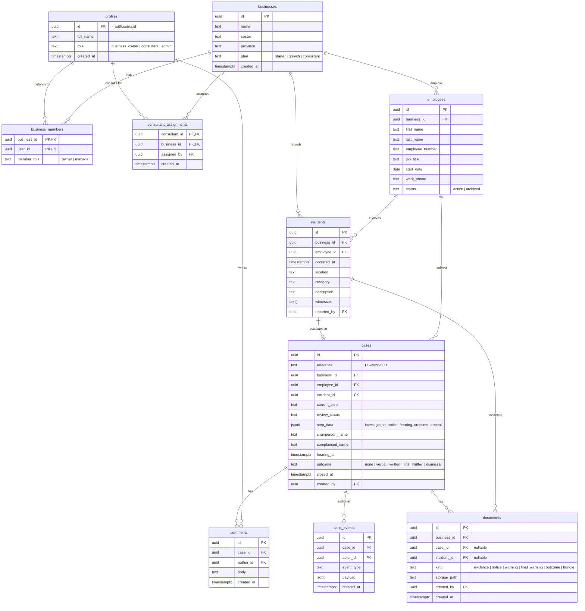

# FairStep: Product Requirements Document

**Version:** 1.0 (Phase 0) · **Owner:** Mandla Sikhosana · **Ship date:** Wed 25 Nov 2026, 15:30 SAST

> **Legal disclaimer.** FairStep provides process guidance and record-keeping based on the *Code of Good Practice: Dismissal* (GN 3470, GG 53294, 4 Sept 2025), which replaced Schedule 8 of the Labour Relations Act. **FairStep is not legal advice.** All rules, notice periods and timeframes in this document and in the code are configurable constants that **must be verified by a qualified labour practitioner** before production use.

---

## 1. Overview

FairStep is a mobile-first web app that guides South African small businesses (5–50 employees) through a fair disciplinary process, blocks procedurally unfair steps, generates the required letters, routes the case to a labour consultant for sign-off, and exports a timestamped CCMA-ready bundle.

Business context: [BUSINESS.md](../BUSINESS.md).

## 2. Roles

Roles are stored in `profiles.role`. A user has exactly one platform role.

| Role | Who | Scope |
|---|---|---|
| `business_owner` | The owner, or a case manager they invite (office manager, HR officer) | **Only** businesses they belong to (via `business_members`) |
| `consultant` | External labour consultant or HR practitioner | **Only** businesses assigned to them (via `consultant_assignments`). Can view, comment, review and sign off. **Cannot delete anything** and cannot edit case facts |
| `admin` | FairStep platform staff | Manages users, businesses and consultant assignments; sees platform stats. Does not run cases |

Employees are **not** users in the MVP.

## 3. User stories

### Business owner / case manager
- **O1** As an owner, I want to add my employees so cases are linked to the right person.
- **O2** As an owner, I want to log an incident the day it happens, with witnesses and photo evidence, so I have a record made at the time.
- **O3** As an owner, I want to start a disciplinary case from an incident and be told what to do next at every step.
- **O4** As an owner, I want FairStep to stop me if I'm about to do something unfair, and tell me why in plain language.
- **O5** As an owner, I want the notice of hearing, warnings and outcome letter generated for me as PDFs.
- **O6** As an owner, I want to send a case to my consultant for review before I act.
- **O7** As an owner, I want to export the whole case as one PDF bundle if the employee refers it to the CCMA.
- **O8** As an owner, I want to see every action on a case, and who did it, on a timeline.

### Consultant
- **C1** As a consultant, I want a queue of cases my clients have sent for review.
- **C2** As a consultant, I want to read the full case (timeline, evidence, documents) and comment on it.
- **C3** As a consultant, I want to request changes or approve (sign off), and have my decision recorded.
- **C4** As a consultant, I must never see businesses that aren't my clients.

### Admin
- **A1** As an admin, I want to see and manage users and businesses.
- **A2** As an admin, I want to assign and unassign consultants to businesses.
- **A3** As an admin, I want platform stats (businesses, active cases, cases by status, review turnaround).

## 4. Features

### Must (day-one product)

#### M1: Employee register + incident log
- Add, edit and archive employees (no hard delete, to protect the audit trail).
- Fields (POPIA-minimal): first name, last name, employee number (optional), job title, start date, work phone/email (optional), status (`active` / `archived`).
- Log an incident: date and time, location, category of misconduct, description, witness names, evidence uploads (images/PDF, max 10 MB each) stored in a **private** Supabase Storage bucket.

**Acceptance criteria**
- [ ] An owner can add an employee, and it appears in the list immediately.
- [ ] An owner can log an incident with at least one evidence file, and the file is viewable only by members of that business and its assigned consultant.
- [ ] Required fields are validated with zod on the server; errors are shown inline.
- [ ] An owner of Business A gets no rows (RLS) when querying Business B's employees, incidents or files.

#### M2: Guided disciplinary workflow (core)
Steps, in order: **Incident → Investigation → Notice of hearing → Hearing → Outcome → Appeal (optional) → Closed**.

All rules are **pure functions** in `src/lib/workflow/` with exhaustive unit tests, driven by constants in `src/lib/workflow/rules.config.ts`. Each constant carries the comment `// Verify with a qualified labour practitioner`.

| Rule | Default constant | Blocks… | Plain-language message (example) |
|---|---|---|---|
| R1 Step order | `STEP_ORDER` | Jumping ahead (e.g. hearing before notice) | "You need to issue a notice of hearing before the hearing can take place." |
| R2 Investigation findings | — | Issuing a notice without investigation findings recorded | "Record what you found in your investigation first, so the allegations are clear." |
| R3 Minimum notice | `MIN_NOTICE_WORKING_DAYS = 2` | Scheduling a hearing less than 2 working days after notice is delivered | "The employee must get at least 2 working days to prepare. The earliest fair date is Wed 26 Nov." |
| R4 Notice content | — | Notice without allegations, date/time/venue, and employee rights (representation, interpreter, witnesses) | "The notice must list the allegations and the employee's rights." |
| R5 Impartial chairperson | — | Chairperson who is the complainant, the investigator or a witness | "The chairperson can't also be the complainant. Choose someone who wasn't involved." |
| R6 Right to respond | — | Recording an outcome without the employee's response, or without a documented reason why there was none (e.g. failed to attend after a postponement) | "Record the employee's side of the story before deciding the outcome." |
| R7 Postponement on non-attendance | `MAX_POSTPONEMENTS_BEFORE_IN_ABSENTIA = 1` | Proceeding in absentia at the first no-show | "Postpone once and re-notify before continuing without the employee." |
| R8 Sanction justification | — | Dismissal without recorded reasons (seriousness, prior warnings, circumstances) | "Explain why dismissal is appropriate, including any prior valid warnings." |
| R9 Appeal window | `APPEAL_WINDOW_WORKING_DAYS = 5` | Lodging an appeal after the window closes | "The appeal period ended on Fri 28 Nov." |
| R10 Warning validity | `WRITTEN_WARNING_VALID_MONTHS = 6`, `FINAL_WARNING_VALID_MONTHS = 12` | Counting expired warnings as prior offences | "This warning expired on 3 May 2026 and can't be counted." |
| R11 Locked after close | — | Editing a closed case (comments still allowed) | "This case is closed. Add a note instead of changing the record." |

Working days exclude weekends and SA public holidays (`SA_PUBLIC_HOLIDAYS` constant).

The 2025 Code allows small businesses a less formal process. FairStep keeps the *substance* (allegations known, time to prepare, chance to respond, impartial decision, reasons given) and lets the hearing be informal.

**Acceptance criteria**
- [ ] `canTransition(case, toStep, now)` returns `{ ok: true }` or `{ ok: false, reasons: [{ code, message }] }`; it is pure and fully unit-tested (every rule R1–R11, both pass and fail cases, plus weekend and public-holiday edge cases).
- [ ] The server action re-runs `canTransition` before every transition; the UI cannot bypass it.
- [ ] Blocked steps show a lock icon and the plain-language reason in the stepper.

#### M3: Document generation
PDFs generated server-side with `@react-pdf/renderer` from case data: **Notice of hearing**, **Written warning**, **Final written warning**, **Outcome letter**. Each has the business letterhead, case reference, generation timestamp and a footer disclaimer. Generated files are saved to Storage and recorded in `documents`.

**Acceptance criteria**
- [ ] A notice can't be generated unless R2–R5 pass.
- [ ] The PDF content matches the case data (unit test on the template props builder).
- [ ] Generating a document writes a `case_events` row.

#### M4: Consultant review and sign-off
Review status: `not_requested → pending_review → changes_requested ⇄ pending_review → approved`. The owner sends a case for review; the consultant comments, requests changes (comment required) or approves. Every status change is a `case_events` row.

**Acceptance criteria**
- [ ] Only a consultant assigned to the case's business can change review status (RLS + server check).
- [ ] "Request changes" without a comment is rejected.
- [ ] The owner sees review status and comments on the case.

#### M5: Case timeline + audit trail + CCMA bundle
- Every mutation inserts an append-only `case_events` row (`actor_id`, `event_type`, `payload`, `created_at`). No update or delete policy exists on `case_events`.
- The **CCMA-ready bundle** is one PDF with a cover page, case summary, the step checklist with completion dates, the full timeline, the list of evidence and all generated documents.

**Acceptance criteria**
- [ ] The timeline shows actor name, role, action and SAST timestamp.
- [ ] No role (including admin) can update or delete `case_events` (tested).
- [ ] The bundle export works for owners and assigned consultants.

### Should (only if time allows)
- **S1** Owner dashboard stats: open cases, cases awaiting review, upcoming hearings, % of cases procedurally complete.
- **S2** Email notifications (review requested, changes requested, approved).
- **S3** Employee acknowledgement of notices via a secure, expiring link.

### Could
- **C1** Afrikaans / isiZulu UI labels.
- **C2** WhatsApp hearing reminders.

## 5. Non-goals (this release)
- Legal advice, or judging *substantive* fairness.
- Retrenchments (operational requirements) and incapacity / poor-performance processes.
- Payroll, leave or general HR.
- Employee logins.
- Payments and billing (plans are shown, not charged).
- Native mobile apps (responsive web only).

## 6. Data model

> `incidents` is a separate table (in addition to the nine core tables) because most incidents never become a hearing. Logging them is the weekly habit that keeps owners engaged (BUSINESS.md A1).

## 7. Permission matrix

Enforced by **RLS policies** (database) **and** server-side checks in Server Actions. ✅ allowed · ❌ denied · *own* = only businesses they are a member of · *assigned* = only businesses assigned to them.

| Action | business_owner | consultant | admin |
|---|---|---|---|
| Sign up / log in / log out | ✅ | ✅ | ✅ |
| View own profile | ✅ | ✅ | ✅ |
| Change any user's role | ❌ | ❌ | ✅ |
| Create business | ✅ (becomes owner) | ❌ | ✅ |
| View business | own | assigned | ✅ all |
| Invite case manager to business | own | ❌ | ✅ |
| Assign / unassign consultant | ❌ | ❌ | ✅ |
| Create / edit employee | own | ❌ | ❌ |
| View employees | own | assigned | ❌ (stats only) |
| Archive employee | own | ❌ | ❌ |
| Hard-delete any record | ❌ | ❌ | ❌ (audit) |
| Log incident + upload evidence | own | ❌ | ❌ |
| View incidents + evidence | own | assigned | ❌ |
| Create case / advance workflow | own | ❌ | ❌ |
| Generate documents | own | ❌ | ❌ |
| Send case for review | own | ❌ | ❌ |
| Comment on case | own | assigned | ❌ |
| Request changes / approve | ❌ | assigned | ❌ |
| View timeline / export bundle | own | assigned | ❌ |
| Update / delete `case_events` | ❌ | ❌ | ❌ |
| View platform stats (aggregates) | ❌ | ❌ | ✅ |

Admins see aggregate counts, not employee personal information (POPIA data minimisation).

## 8. Non-functional requirements
- **Security:** RLS enabled on every table; Storage buckets private; service-role key used only server-side for admin actions; zod validation on every mutation.
- **Responsive:** mobile-first (360px) up to desktop (1440px); touch targets ≥ 44px.
- **Accessibility:** WCAG 2.1 AA contrast; keyboard navigable; the stepper uses `aria-current="step"`.
- **Time zone:** stored in UTC, displayed in SAST (Africa/Johannesburg).
- **Quality gates:** CI runs lint, typecheck, unit tests and build on every PR; Playwright covers the main flow.

## 9. Main end-to-end flow (Playwright)
Owner logs in → logs incident → starts case → records investigation → issues notice (PDF) → records hearing → records outcome → sends for review → consultant logs in → approves → owner exports CCMA bundle.
